# Information Architecture & Content Strategy Audit

## Project: Register of Trade Unions — PNG Department of Labour & Industrial Relations

---

## 1. Executive Summary

- **[Observed]** The build is a Next.js 16 single-page application with three distinct audience surfaces — a public register, a union representative portal, and a role-filtered staff dashboard — all served from a single root route (`/`) using client-side mode-switching, with one separate Server Component route for public union detail (`/unions/[registrationNo]`) and one for printable compliance reports (`/reports/compliance`). `src/app/page.tsx:42-303`

- **[Observed]** A "single source of truth" discipline governs navigation and labels: `nav-structure.ts` drives the menu, Cmd+K palette, quick actions, and breadcrumbs; `vocabulary.ts` drives all status labels, role labels, view titles, and notification link formats. Contract tests enforce alignment. `src/lib/dashboard/nav-structure.ts:1-8`; `src/lib/dashboard/vocabulary.ts:1-35`

- **[Observed]** Six compliance statuses (Compliant, Expiring, Overdue, Awaiting Review, Missing, Not Applicable) are computed live — never stored — from document + rule + version inputs via a pure function, ensuring the answer to "is this union compliant?" is always current. `src/lib/compliance/calculator.ts:237-322`

- **[Observed]** The retention/disposition/legal-hold workflow is feature-flagged off by default (`NEXT_PUBLIC_RETENTION_ENABLED`), hiding it from all UI surfaces and returning 404 from all 8 API routes until the office is ready to use it. `src/lib/retention-flag.ts:36-38`

- **[Inferred]** The product appears designed for a real-world deployment at the PNG Office of The Industrial Registrar, with realistic contact details, five PNG-specific legislative PDFs, and role descriptions matching a registrar-inspector-officer-representative hierarchy — though no production deployment URL was provided.

---

## 2. Scope and Evidence Examined

### Materials accessed

| Material | Location | Completeness |
|---|---|---|
| Full source repository | `/home/z/my-project/src/` | Complete — 267 `.ts`/`.tsx` files |
| Database schema | `prisma/schema.prisma` | Complete — 16 models, 10 enums, 567 lines |
| API routes | `src/app/api/` | Complete — 94 `route.ts` files |
| Page routes | `src/app/` | Complete — 5 page routes (incl. root SPA) |
| Component library | `src/components/` | Complete — 50 shadcn/ui primitives + 19 staff views + 5 portal views + 15 app components |
| Configuration | `.env` (var names only — values redacted) | Complete |
| Work log | `worklog.md` | Complete — 690 lines documenting all session tasks |
| Tests | `src/lib/__tests__/` | Complete — 30 test files, 610 tests passing |
| Public assets | `public/legislation/` | Complete — 5 PDFs + 1 JSON |
| Package manifest | `package.json` | Complete |

### Limitations

- **No live URL was provided** — all findings are from source inspection, not runtime observation.
- **No screenshots were taken during this audit** — UI behavior is inferred from component source code, not visual confirmation.
- **The `download/` directory** contains historical screenshots from earlier sessions but these were not systematically reviewed.
- **The `docs/` directory** was not inspected.
- **Agent/AI workflows**: the `z-ai-web-dev-sdk` dependency exists in `package.json` and image-edit/LLM/VLM/TTS/ASR skills are installed under `skills/`, but no agent orchestration code was found in the application source (`src/`). The skills appear to be development-environment tooling, not user-facing product features.

---

## 3. Page and Route Inventory

### User-facing page routes (5)

| # | Route | File | Audience | Purpose |
|---|---|---|---|---|
| 1 | `/` | `src/app/page.tsx` | All | SPA entry — switches between Public Portal, Login, and Staff Dashboard based on auth state + URL params |
| 2 | `/unions/[registrationNo]` | `src/app/unions/[registrationNo]/page.tsx` | Public | Server-rendered union detail with public documents + print button |
| 3 | `/portal` | `src/app/portal/page.tsx` | Representatives | Union self-service portal (redirect target for REPRESENTATIVE role) |
| 4 | `/reports/compliance` | `src/app/reports/compliance/page.tsx` | Staff (all roles) | Printable compliance report (opens in new tab, Server Component) |
| 5 | _(root layout)_ | `src/app/layout.tsx` | All | HTML shell, font loading, theme provider |

### Staff dashboard views (21 — rendered via `?view=` param on `/`)

| View | Component | REGISTRAR | INSPECTOR | OFFICER |
|---|---|---|---|---|
| dashboard | `views/dashboard.tsx` | ✓ | ✓ | ✓ |
| unions | `views/unions.tsx` | ✓ | ✓ | — |
| my-union | `views/unions.tsx` (same) | — | — | ✓ |
| documents | `views/documents.tsx` | ✓ | ✓ | ✓ |
| document-detail | `views/document-detail.tsx` | ✓ | ✓ | ✓ |
| compliance | `views/compliance.tsx` | ✓ | ✓ | ✓ |
| configure-rules | `views/configure-rules.tsx` | ✓ | — | — |
| compare | `views/compare.tsx` | ✓ | ✓ | — |
| tasks | `views/tasks.tsx` | ✓ | ✓ | ✓ |
| calendar | `views/calendar.tsx` | ✓ | ✓ | ✓ |
| reviews | `views/reviews.tsx` | ✓ | — | — |
| retention | `views/retention.tsx` | ✓ (flag-gated) | — | — |
| contact-requests | `views/contact-requests.tsx` | ✓ | — | — |
| search | `views/search.tsx` | ✓ | ✓ | ✓ |
| audit | `views/audit.tsx` | ✓ | ✓ | — |
| users | `views/users.tsx` | ✓ | — | — |
| security | `views/security.tsx` | ✓ | — | — |
| api-keys | `views/api-keys.tsx` | ✓ | — | — |
| webhooks | `views/webhooks.tsx` | ✓ | — | — |
| legislation (Resources) | `views/legislation.tsx` | ✓ | — | — |
| account-security | `views/account-security.tsx` | ✓ | ✓ | ✓ |
| help | `views/help-guide.tsx` | ✓ | ✓ | ✓ |

### Portal views (5 — rendered via `?view=` param on `/portal`)

| View | Component | Purpose |
|---|---|---|
| dashboard | `portal/views/dashboard.tsx` | Compliance summary for the rep's union |
| documents | `portal/views/documents.tsx` | View + upload documents |
| compliance | `portal/views/compliance.tsx` | Compliance status (read-only) |
| tasks | `portal/views/tasks.tsx` | Read-only task list |
| contact | `portal/views/contact.tsx` | Submit contact-info update requests |

### API routes (94 — see §2 inventory for full list)

**Inventory is complete** — every `route.ts` file under `src/app/api/` was verified by the packaging-check test (`src/lib/__tests__/packaging-check.test.ts`). All 77 UI-referenced API URLs resolve to route files.

---

## 4. Information Architecture

### Sitemap (nested outline)

```
PUBLIC (unauthenticated)
├── / (Public Portal)
│   ├── ?tab=register — Registered Unions list (searchable, links to union detail)
│   ├── ?tab=resources — Legislation library (5 PDFs + descriptions)
│   └── ?tab=help — Status glossary (union + compliance statuses explained)
├── /unions/[registrationNo] — Union detail (public documents, print, contact)
├── /?login=1 — Staff sign-in (password → 2FA)
│   └── /?login=1&step=forgot — Forgot password (self-service reset)
└── /?token=XXX — Set password (consumes reset token)

STAFF (authenticated: REGISTRAR / INSPECTOR / OFFICER)
└── / (Staff Dashboard — SPA, ?view= param)
    ├── dashboard — Overview (KPIs, charts, activity feed, quick actions)
    ├── unions / my-union — Union list + detail + document upload
    ├── documents — Cross-union document list (filterable)
    ├── document-detail — Single document + versions + download
    ├── compliance — Compliance matrix (unions × document types)
    ├── configure-rules — Compliance rule editor (REGISTRAR only)
    ├── compare — Side-by-side compliance comparison (2-6 unions)
    ├── tasks — Task list (click-to-cycle status, cancel, delete)
    ├── calendar — Compliance calendar (expirations by month)
    ├── reviews — Document review queue (REGISTRAR only)
    ├── retention — Retention queue (REGISTRAR only, feature-flagged off)
    ├── contact-requests — Contact update approval queue (REGISTRAR only)
    ├── search — Full-text search (filters + pagination)
    ├── audit — Audit log (filterable, paginated)
    ├── users — User management (REGISTRAR only)
    ├── security — Security dashboard (REGISTRAR only)
    ├── api-keys — API key management (REGISTRAR only)
    ├── webhooks — Webhook endpoint management (REGISTRAR only)
    ├── legislation (Resources) — Legislation library CRUD (REGISTRAR only)
    ├── account-security — 2FA setup, password change, session management
    └── help — Role-based guide + status glossary

REPRESENTATIVE (authenticated: REPRESENTATIVE)
└── /portal (Portal — SPA, ?view= param)
    ├── dashboard — Compliance summary
    ├── documents — View + upload
    ├── compliance — Read-only status
    ├── tasks — Read-only task list
    └── contact — Submit contact-info update request

EXTERNAL
└── /reports/compliance — Printable compliance report (new tab)
```

### Mermaid sitemap diagram

```mermaid
graph TD
    ROOT["/ (SPA Entry)"]

    %% Public
    ROOT -->|"unauthenticated"| PUBLIC["Public Portal"]
    PUBLIC -->|"?tab=register"| REGISTER["Registered Unions"]
    PUBLIC -->|"?tab=resources"| RESOURCES["Resources / Legislation"]
    PUBLIC -->|"?tab=help"| HELP_PUB["Help — Status Glossary"]
    REGISTER -->|"click union"| UNION_DETAIL["/unions/[registrationNo]<br/>Union Detail"]

    %% Auth entry
    ROOT -->|"Sign In"| LOGIN["Login Screen<br/>/?login=1"]
    LOGIN -->|"Forgot password?"| FORGOT["Forgot Password<br/>/?login=1&step=forgot"]
    LOGIN -->|"password verified"| STAFF["Staff Dashboard"]
    LOGIN -->|"REPRESENTATIVE role"| PORTAL["/portal Representative Portal"]

    %% Staff
    STAFF --> DASH["Dashboard"]
    STAFF --> UNIONS["Unions / My Union"]
    STAFF --> DOCS["Documents"]
    STAFF --> COMPLIANCE["Compliance"]
    STAFF --> TASKS["Tasks"]
    STAFF --> CALENDAR["Calendar"]
    STAFF --> SEARCH["Search"]
    STAFF --> HELP_STAFF["Help & Guide"]
    STAFF --> WORKQ["Work Queues"]
    STAFF --> ADMIN["Admin"]

    WORKQ --> REVIEWS["Review Queue"]
    WORKQ --> CONTACT_REQ["Contact Updates"]
    WORKQ -.->|"flag-gated"| RETENTION["Retention Queue"]

    ADMIN --> AUDIT["Audit"]
    ADMIN --> USERS["Users"]
    ADMIN --> SECURITY["Security"]
    ADMIN --> APIKEYS["API Keys"]
    ADMIN --> WEBHOOKS["Webhooks"]
    ADMIN --> LEGIS["Resources"]

    UNIONS --> DOC_DETAIL["Document Detail"]
    DOCS --> DOC_DETAIL

    %% Portal
    PORTAL --> P_DASH["Dashboard"]
    PORTAL --> P_DOCS["Documents"]
    PORTAL --> P_COMPLIANCE["Compliance Status"]
    PORTAL --> P_TASKS["Tasks (read-only)"]
    PORTAL --> P_CONTACT["Contact Info"]

    %% External
    STAFF -.->|"new tab"| REPORT["/reports/compliance<br/>Printable Report"]
```



**Legend**: solid = observed navigation path; dotted = feature-flagged or external (new tab).

### Navigation

#### Global navigation

| Surface | Mechanism | Source of truth | Evidence |
|---|---|---|---|
| Staff top nav | HorizontalNav — 9 groups, role-filtered | `getNavForRole(role, retentionEnabled)` | `src/components/app/app-shell.tsx:264` |
| Portal top nav | Flat 5-item nav (no dropdowns) | `PORTAL_NAV` local array | `src/components/portal/portal-shell.tsx:67-73` |
| Public tabs | 3-tab bar (Register/Resources/Help) | `useState<PublicTab>` with URL sync | `src/components/app/public-portal.tsx:26-50` |

#### Local navigation

| Surface | Mechanism | Evidence |
|---|---|---|
| Cmd+K palette | GlobalSearch dialog — all visible destinations + document-content search | `src/components/app/global-search.tsx:165-173` |
| Dashboard quick actions | 3-5 buttons derived from `getQuickActions(role)` — task-gated (not destination-gated) | `src/components/app/views/dashboard.tsx:1482-1513` |
| Document detail | "View document →" links from search results, union detail, compliance cells | `src/components/app/views/search.tsx:216-221` |

#### Breadcrumbs

| Surface | Mechanism | Evidence |
|---|---|---|
| Staff | `buildBreadcrumbs(activeView, role)` — role-filtered, "Home > [Group] > Page" | `src/components/app/app-shell.tsx:50-85` |
| Portal | Local `buildBreadcrumbs(activeView)` — "Home > Page" | `src/components/portal/portal-shell.tsx:75-81` |
| Public union detail | "Back to Register" + "Sign In" buttons | `src/app/unions/[registrationNo]/page.tsx:54-58` |

#### Footer navigation

| Surface | Content | Evidence |
|---|---|---|
| Public portal | "Office of The Industrial Registrar" / "PNG Department of Labour & Industrial Relations" / RegistrarContactInfo (compact) / copyright / "For enquiries, contact the Office..." | `src/components/app/public-portal.tsx:257-265` |
| Public union detail | Same footer + enquiry card with RegistrarContactInfo (card variant) | `src/app/unions/[registrationNo]/page.tsx:110-146` |
| Staff / Portal | No footer — content area fills the viewport | [Observed] — no footer component in AppShell or PortalShell |

#### Calls to action

| CTA | Location | Evidence |
|---|---|---|
| "Sign In" | Public portal header | `public-portal.tsx:124` |
| "Register Union" | Dashboard quick actions (REGISTRAR) | `nav-structure.ts:191` |
| "Upload Document" | Dashboard quick actions (REGISTRAR + OFFICER) | `nav-structure.ts:194,199` |
| "Create Task" | Dashboard quick actions (all staff) | `nav-structure.ts:215` |
| "View Audit Log" | Dashboard quick actions (REGISTRAR + INSPECTOR) | `nav-structure.ts:230` |
| "Compliance Report" | Dashboard quick actions (all staff) | `nav-structure.ts:460-466` |
| "Generate Report" | Compliance view toolbar | `compliance.tsx:173-186` |
| "New Task" | Tasks view header | `tasks.tsx:94-97` |
| "Forgot password?" | Login form password field | `login-form.tsx:154-160` |

### Organization system

**[Observed]** The staff dashboard organizes information by **task domain** (not by entity type):
- **Unions** group: everything about managing/inspecting union records
- **Compliance** group: compliance matrix + rule configuration
- **Work Queues** group: actionable queues requiring Registrar attention (Review, Contact Updates, Retention)
- **Admin** group: system administration (Audit, Users, Security, API Keys, Webhooks, Resources)
- **Help** group: role-based guidance + glossary

**[Observed]** The public portal organizes by **user intent**: Register (browse the list), Resources (read legislation), Help (understand terms).

**[Inferred]** The portal organizes by **representative workflow**: Dashboard (overview) → Documents (upload) → Compliance (check status) → Tasks (see what's pending) → Contact Info (update details).

### Labels and taxonomy

| Term | Where used | Variants or inconsistencies | Evidence |
|---|---|---|---|
| Resources | Nav item, page heading, public tab | Internal route name is `legislation`; API is `/api/legislation`; TypeScript type is `LegislationEntry` | `vocabulary.ts:290-294`; `nav-structure.ts:237` |
| Compliance | Nav item (staff), page heading | Staff: "Compliance"; Portal: "Compliance Status" — intentional difference per `vocabulary.ts:24-25` | `vocabulary.ts:254,265` |
| Audit | Nav item | Alias "Audit Log" kept for fuzzy search only; page heading is "Audit" (was "Audit Log") | `nav-structure.ts:230`; `vocabulary.ts:274` |
| Rules | Nav item | Alias "Configure Rules"; internal route `configure-rules` | `nav-structure.ts:222` |
| Retention Queue | Nav item | Alias "Retention"; hidden when `NEXT_PUBLIC_RETENTION_ENABLED` is off | `nav-structure.ts:233` |
| Awaiting Review | Compliance status | New (was folded into Missing); blue color; "R" in compare grid | `vocabulary.ts:77-83` |
| Missing | Compliance status | Definition changed — no longer mentions review (now in Awaiting Review) | `vocabulary.ts:84-90` |
| Not Applicable | Vocabulary, glossary | Local copy in `compliance.tsx:68` says "N/A" — **diverges** from canonical "Not Applicable" | `vocabulary.ts:91-97`; `compliance.tsx:68` |
| Pending Review | Review status | Was "Pending" — intentionally renamed for clarity | `vocabulary.ts:108` |
| To Do | Task status (PENDING) | Was "Pending" in old code; now "To Do" per task vocabulary | `vocabulary.ts:151` |
| Done | Task status (COMPLETED) | Was "Completed" in staff Tasks view local copy; now "Done" per shared vocabulary | `vocabulary.ts:161` |
| Contact Updates | Nav item, page heading | Was "Contact Update Requests"; alias kept for search | `vocabulary.ts:272`; `nav-structure.ts:232` |
| Help & Guide | Nav item, page heading | Aliases: "Guide", "Glossary", "Status Glossary" | `nav-structure.ts:239` |

### Findability

| Mechanism | Where | Evidence |
|---|---|---|
| Cmd+K global search palette | All staff screens | `src/components/app/global-search.tsx` — searches nav destinations + union names + task titles + user emails + document content |
| Full-text document search | `?view=search` | `src/app/api/search/route.ts` — LIKE-based, whitespace-flexible, 20 per page, filterable by union/type/review-status |
| Compliance matrix filter | `?view=compliance&status=X` | `src/components/app/views/compliance.tsx:187-200` — 7 options (All + 6 statuses) |
| Audit log filters | `?view=audit&entityType=X&action=X&actor=X&startDate=X&endDate=X&page=N` | `src/components/app/views/audit.tsx:62-120` — 5 filter fields + pagination |
| Union name filter | Public portal register tab | `src/components/app/public-portal.tsx:74` — client-side filter |
| Documents filter | `?view=documents` | `src/components/app/views/documents.tsx:86-103` — union + type + review-status + text search |
| Search result filters | `?view=search&q=X&union=Y&documentType=Z&reviewStatus=W&page=N` | `src/components/app/views/search.tsx:96-103` — 3 filters + pagination |
| Status glossary | `?tab=help` (public) + `?view=help` (staff) | `src/components/app/status-glossary.tsx` — driven by `vocabulary.ts` configs |
| Tooltips | Dashboard KPI cards, compliance legend, reviews "Pending" badge | Definitions from `STATUS_CONFIG` + `REVIEW_STATUS_CONFIG` |

**[Observed]** Key findability tasks supported:
- "Find a specific union" → public register filter or Cmd+K palette
- "Find a document mentioning 'secret ballot'" → Search view with full-text + filters + pagination
- "See which unions are overdue" → Compliance view, filter to "Overdue only"
- "See what documents are awaiting my review" → Compliance view, filter to "Awaiting Review only" (or Review Queue for action items)
- "Understand what 'Suspended' means" → Help tab (public) or Help & Guide (staff)

**[Not established]** No faceted search, saved searches, or search-history features were found.

---

## 5. Content and Data Model

### Content types

| Content type | Source | Key fields | Relationships |
|---|---|---|---|
| Union | DB: `Union` model | unionName, registrationNo (unique), fileNumber, status, address, contactPerson/Email/Phone | has many Documents, Tasks, ContactUpdateRequests |
| Document | DB: `Document` model | documentType, reviewStatus, isPublic, disposedAt, snoozedUntil | belongs to Union; has many DocumentVersions; has LegalHolds, DispositionRequests |
| DocumentVersion | DB: `DocumentVersion` model | versionNumber, fileName, filePath, checksum, textContent, uploadedAt, effectiveDate | belongs to Document; self-relation via supersedes |
| ComplianceRule | DB: `ComplianceRule` model | documentType (unique), required, renewalYears, retentionYrs, sensitive | referenced by calculator (not FK-linked) |
| Task | DB: `Task` model | title, description, status, priority, dueDate | belongs to Union? (optional); assignee User; creator User |
| AuditLog | DB: `AuditLog` model | actorName, action, entityType, entityId, beforeJson, afterJson, severity | actor User? (optional) |
| Notification | DB: `Notification` model | type, title, body, dedupKey, linkUrl, readAt | belongs to User |
| Legislation | JSON: `public/legislation/legislation.json` | id, title, shortTitle, year, jurisdiction, category, summary, url, lastUpdated | none — flat file |
| ComplianceSnapshot | DB: `ComplianceSnapshot` model | date (unique), compliant, expiring, overdue, awaitingReview, missing, rateNumerator, rateDenominator, capturedWith | none — append-only daily history |

### Sources of truth

| Data | Source of truth | Evidence |
|---|---|---|
| Compliance status | **Computed live** — never stored. `calculateStatus(rule, document, latestVersion, now)` | `src/lib/compliance/calculator.ts:237-322` |
| Navigation + labels | `nav-structure.ts` + `vocabulary.ts` | Contract tests enforce alignment |
| Contact details | `NEXT_PUBLIC_REGISTRAR_*` env vars | `src/lib/registrar-contact.ts` |
| Legislation library | `public/legislation/legislation.json` (file-based CMS) | `src/app/api/legislation/route.ts:38-46` |
| Status definitions | `vocabulary.ts` `COMPLIANCE_STATUS_CONFIG` + `STATUS_CONFIG` in `status-config.ts` | Two parallel configs — `vocabulary.ts` for UI labels, `status-config.ts` for CSS tokens + dashboard |
| Daily compliance history | `ComplianceSnapshot` DB table — append-only, past rows immutable | `prisma/schema.prisma:406-426` |

### Mermaid ER diagram (core entities)

```mermaid
erDiagram
    Union ||--o{ Document : has
    Union ||--o{ Task : has
    Union ||--o{ ContactUpdateRequest : has
    Document ||--o{ DocumentVersion : has
    Document ||--o{ LegalHold : has
    Document ||--o{ DispositionRequest : has
    Document }o--|| ComplianceRule : "type matches"
    User ||--o{ Task : "assigned/created"
    User ||--o{ AuditLog : "actor"
    User ||--o{ Notification : receives
    User ||--o{ Session : has
    User ||--o{ ApiKey : creates
    WebhookEndpoint ||--o{ WebhookDelivery : has

    Union {
        string id PK
        string unionName
        string registrationNo UK
        string fileNumber
        enum UnionStatus status
        string address
        string contactPerson
        string contactEmail
        string contactPhone
    }
    Document {
        string id PK
        string unionId FK
        string documentType
        enum ReviewStatus reviewStatus
        boolean isPublic
        datetime disposedAt
        datetime snoozedUntil
    }
    DocumentVersion {
        string id PK
        string documentId FK
        int versionNumber
        string fileName
        string filePath
        string checksum
        string textContent
        datetime uploadedAt
    }
    ComplianceRule {
        string id PK
        string documentType UK
        boolean required
        int renewalYears
        int retentionYrs
    }
    Task {
        string id PK
        string title
        enum TaskStatus status
        string priority
        datetime dueDate
        string unionId FK
        string assigneeId FK
        string createdById FK
    }
    AuditLog {
        string id PK
        string actorName
        string action
        string entityType
        string entityId
        enum Severity severity
    }
    ComplianceSnapshot {
        string id PK
        string date UK
        int compliant
        int expiring
        int overdue
        int awaitingReview
        int missing
        int rateNumerator
        int rateDenominator
    }
```

### Implementation organization

**[Observed]** The codebase follows a **feature-domain split**:
- `src/app/api/` — API routes organized by domain (auth, users, unions, compliance, tasks, etc.)
- `src/components/app/views/` — One component per staff view (21 files)
- `src/components/portal/views/` — One component per portal view (5 files)
- `src/lib/dashboard/` — Dashboard domain logic (nav, vocabulary, status, metrics, snapshot)
- `src/lib/compliance/` — Compliance domain logic (calculator, matrix, report)
- `src/lib/auth/` — Auth domain (guard, session, password, TOTP)
- `prisma/schema.prisma` — Single schema file, SQLite datasource

**[Observed]** The SPA architecture means **software routing ≠ user-facing IA**. All staff views share one Next.js route (`/`); the `?view=` param is the user-facing "route." This is a deliberate choice for fast in-app navigation but means the browser's URL bar is the only record of the current view — there are no server-rendered pages for individual staff views.

---

## 6. Agentic Workflow Analysis

**[Observed]** No agent or AI workflow code was found in the application source (`src/`). The `z-ai-web-dev-sdk` dependency and the `skills/` directory (ASR, LLM, TTS, VLM, image-generation, image-edit, image-search, web-search, web-reader, video-understand) are **development-environment tooling** — they are not imported by any file under `src/` and do not appear in any user-facing feature.

**[Observed]** The system does have **automated workflows** (cron jobs) that perform scheduled actions without human intervention:

| Cron route | Trigger | Action | Evidence |
|---|---|---|---|
| `/api/cron/compliance-sweep` | Scheduled (cron.sh) | Checks all documents for expiring/overdue status; creates notifications for assigned officers | `src/app/api/cron/compliance-sweep/route.ts` |
| `/api/cron/compliance-snapshot` | Daily | Captures daily compliance counts to `ComplianceSnapshot` table | `src/app/api/cron/compliance-snapshot/route.ts` |
| `/api/cron/compliance-digest` | Scheduled | Sends a summary email to Registrars | `src/app/api/cron/compliance-digest/route.ts` |
| `/api/cron/webhook-retry` | Scheduled | Retries failed webhook deliveries with exponential backoff | `src/app/api/cron/webhook-retry/route.ts` |
| `/api/cron/audit-retention-sweep` | Scheduled | Deletes old audit log entries by severity tier | `src/app/api/cron/audit-retention-sweep/route.ts` |
| `/api/cron/snapshot-retention-sweep` | Scheduled | Deletes old compliance snapshots | `src/app/api/cron/snapshot-retention-sweep/route.ts` |

These are **deterministic scheduled tasks**, not AI agents. They do not make decisions, generate content, or interact with users. No agent prompts, tool definitions, or orchestration code exist in the application.

**[Not established]** Whether any AI/agent features are planned for future versions. The `z-ai-web-dev-sdk` presence in `package.json` suggests the development environment supports AI features, but none are wired into the product.

---

## 7. Content Strategy

### Value proposition (inferred)

**[Inferred]** The product communicates: *"This is the official, transparent register of trade unions in Papua New Guinea — maintained by the Industrial Registrar for public verification, union self-service, and staff oversight."* The likely audience is three-tiered: the general public (researchers, union members), union representatives (self-service), and Office staff (Registrars, Inspectors, Officers). The action it encourages is: public users verify union status; representatives upload documents; staff manage compliance.

### Content inventory

| Page/area | Purpose | Headings or key copy | CTA | Evidence |
|---|---|---|---|---|
| Public portal — Register | Browse registered unions | "Register of Trade Unions" / "Registered Unions" / "All trade unions currently on the public register. Click a union to view its published documents." | Click a union card | `public-portal.tsx:51-57,69-70` |
| Public portal — Resources | Read legislation | "Resources" / "Acts and regulations governing trade unions in Papua New Guinea." | "View PDF" (external link) | `public-portal.tsx:104-105` |
| Public portal — Help | Understand terms | "What These Terms Mean" / "A short guide to the words used on this register." | None (informational) | `public-portal.tsx:148-151` |
| Union detail | View a union's public record | "{unionName}" / "Published Documents" / "For enquiries regarding this union, contact the Office of The Industrial Registrar" | "Print" / "Open in Dashboard" (if staff) | `src/app/unions/[registrationNo]/page.tsx:85-109` |
| Login — password | Staff sign-in | "Sign in" / "Enter your credentials to access the registry." | "Sign in" / "Forgot password?" | `login-form.tsx:139-141` |
| Login — forgot | Self-service password reset | "Forgot Password" / "Enter your email and we'll send you a link to set a new password." | "Send Reset Link" | `forgot-password-form.tsx:131-133` |
| Staff dashboard | Overview + quick actions | "Dashboard" / "Overview of the union registry and compliance status." | 3-5 quick-action buttons | `dashboard.tsx:1468-1513` |
| Compliance matrix | View compliance status | "Compliance Matrix" / "Live compliance status for every union × document type. Computed on every read — no caching." | "Generate Report" / status filter | `compliance.tsx:167-169` |
| Help & Guide | Role-based guidance | "Help & Guide" / "A short guide to your role, the tasks you'll do most, and what the status terms mean." | Click task card to navigate | `help-guide.tsx:226-232` |
| Portal dashboard | Rep compliance overview | "Dashboard" (inferred from PORTAL_NAV) | None (informational) | `portal-shell.tsx:68` |

### Messaging hierarchy — Public portal homepage

```
Headline: "Register of Trade Unions"
    ↓
Supporting message: "The official public list of trade unions registered
    under the Industrial Organizations Act. Published by the Office of
    The Industrial Registrar for transparency and public verification."
    ↓
Details: "Last updated: {date}" + "This register is published in accordance
    with Section 5 of the Industrial Organizations Act, which requires the
    Registrar to maintain a public register of registered trade unions."
    ↓
Microcopy: "Published by the Industrial Registrar" (badge pill)
    ↓
CTA: {Union cards} — click to view detail
```

### Messaging hierarchy — Staff login

```
Headline: "Register of Trade Unions"
    ↓
Supporting message: "Office of The Industrial Registrar / PNG Department
    of Labour & Industrial Relations"
    ↓
Details: "Sign in" / "Enter your credentials to access the registry."
    ↓
Microcopy: "Email" (placeholder: you@example.com) / "Password" (placeholder: ••••••••)
    ↓
CTA: "Sign in" (button) / "Forgot password?" (inline link)
```

### Messaging hierarchy — Document upload flow (Officer)

```
Headline: "My Union" (from nav)
    ↓
Supporting message: [Inferred from UnionsView — union name + registration no.]
    ↓
Details: Document list with type + version + status + expiry
    ↓
Microcopy: "Upload Document" (quick action button label) /
    "Pending Review" (badge after upload) /
    "Document has been uploaded by a union representative or officer,
     but the Registrar has not yet approved it." (tooltip definition)
    ↓
CTA: "Upload Document" → file picker → toast "Document uploaded."
```

### Voice and tone analysis

**[Inferred]** The voice is **official, precise, and plain-language** — consistent with a government register. It avoids jargon where possible but uses regulatory terms (Registrar, Industrial Organizations Act, registration number) where they are the correct legal terms. The tone varies by audience:

| Audience | Tone | Example | Evidence |
|---|---|---|---|
| Public | Formal but accessible | "The official public list of trade unions registered under the Industrial Organizations Act. Published by the Office of The Industrial Registrar for transparency and public verification." | `public-portal.tsx:53-56` |
| Staff (error) | Direct, blame-free | "Invalid email or password. 2 attempt(s) remaining." | `src/app/api/auth/login/route.ts:217-218` |
| Staff (success) | Warm, brief | "Welcome back!" | `login-form.tsx:49` |
| Staff (help) | Instructional, second-person | "You are the system administrator. You can do everything: manage unions, review documents, configure compliance rules, and manage users." | `help-guide.tsx:40` |
| System (notification) | Factual, actionable | "Highlands Coffee Growers Association: Financial Return expiring soon" | [Observed in DB via check script] |

**[Observed]** Consistency is high — the vocabulary.ts file explicitly catalogs naming decisions and contract tests enforce alignment. The one exception is the `compliance.tsx` local STATUS_CONFIG using "N/A" instead of the canonical "Not Applicable."

### Microcopy inventory (representative samples)

| Category | Copy | Source |
|---|---|---|
| **Button — primary** | "Sign in" | `login-form.tsx:155` |
| **Button — loading** | "Signing in..." | `login-form.tsx:155` |
| **Button — secondary** | "Back to Public Portal" | `login-form.tsx:174` |
| **Button — action** | "Register Union" / "Upload Document" / "Create Task" / "View Audit Log" / "Compliance Report" | `nav-structure.ts` quickAction shortLabels |
| **Form label** | "Email" / "Password" / "Verification code" | `login-form.tsx:143,151,172` |
| **Placeholder** | "you@example.com" / "••••••••" / "Filter by name or registration number..." | `login-form.tsx:143,155`; `public-portal.tsx:74` |
| **Validation** | "Email is required." / "Please enter a valid email address." / "Password is required." / "Code must be 6 digits." | `src/lib/validation.ts:39-48`; `login-form.tsx:168` |
| **Error — auth** | "Invalid email or password. {N} attempt(s) remaining." / "Account locked for {N} minutes due to repeated failed attempts." / "This account has been disabled. Contact the registrar." | `src/app/api/auth/login/route.ts:169,218,139` |
| **Error — network** | "Network error. Please try again." | `login-form.tsx:51` |
| **Empty state** | "No unions found" / "No documents pending review" / "No tasks yet" / "No audit entries found" | `public-portal.tsx:79`; `reviews.tsx:88`; `tasks.tsx:102`; `audit.tsx:203` |
| **Loading** | "Loading..." / "Searching..." / "Setting password..." | `page.tsx:157`; `search.tsx:149`; `set-password-form.tsx:133` |
| **Confirmation** | "Welcome back!" / "Password set successfully!" / "Task moved to {status}." / "Document approved." / "All notifications marked as read." | `login-form.tsx:49`; `set-password-form.tsx:73`; `tasks.tsx:165`; `reviews.tsx:58`; `app-shell.tsx:300` |
| **Forgot password** | "If an account exists for that email, a password reset link has been sent. The link will expire in 1 hour." | `src/app/api/auth/forgot-password/route.ts:79-83` |
| **Retention disabled** | "The retention workflow is not enabled. Set NEXT_PUBLIC_RETENTION_ENABLED=true to enable it." | `src/lib/retention-flag.ts:46-47` |
| **Search placeholder** | "Search document contents (e.g., 'secret ballot', 'award variation')..." | `search.tsx:117` |
| **Glossary intro** | "These are the same terms you'll see on the Dashboard, Compliance, and other screens. Hover over a status on the Dashboard to see a short definition — the same definitions are spelled out here." | `help-guide.tsx:305-307` |

### Repeated content + reusable components

| Component | Reused in | Evidence |
|---|---|---|
| `StatusGlossary` | Public Help tab + Staff Help & Guide | `src/components/app/status-glossary.tsx` |
| `RegistrarContactInfo` | Public footer + public union detail enquiry card + staff Help guide | `src/components/app/registrar-contact-info.tsx` |
| `StatusBadge` | Public union list + public union detail + compliance matrix | `src/components/app/status-badge.tsx` |
| `ReviewStatusBadge` | Search results + reviews view | `src/components/app/views/search.tsx:239` |
| Notification date-grouping logic | AppShell + PortalShell (duplicated, not shared) | `app-shell.tsx:309-333`; `portal-shell.tsx:132-150` |

**[Observed]** Content is stored in code (not in a CMS) with two exceptions: legislation library data is in `public/legislation/legislation.json` (file-based), and contact details are in `NEXT_PUBLIC_REGISTRAR_*` env vars. All other content (labels, definitions, microcopy) is in TypeScript source files.

**[Not established]** No localization infrastructure exists beyond the `next-intl` dependency in `package.json` — no locale files, no `useTranslations` calls were found. The product is English-only.

---

## 8. IA Gaps and Content-Strategy Gaps

### Top IA gaps

| # | Finding | Severity | Evidence | Impact |
|---|---|---|---|---|
| 1 | **`compliance.tsx` has a local `STATUS_CONFIG` that duplicates `COMPLIANCE_STATUS_CONFIG`** with a divergent label ("N/A" vs "Not Applicable"). This is the exact drift pattern `vocabulary.ts` was created to prevent. | High | `src/components/app/views/compliance.tsx:62-69` vs `src/lib/dashboard/vocabulary.ts:91-97` | Users see "N/A" on the Compliance screen but "Not Applicable" in the Help glossary and vocabulary. Inconsistent labeling erodes trust in an official register. |
| 2 | **Portal navigation is a separate hard-coded array** (`PORTAL_NAV` in `portal-shell.tsx:67-73`), not derived from `nav-structure.ts`. The portal can drift from the staff nav's labeling/role conventions. | Medium | `src/components/portal/portal-shell.tsx:67-73` | Adding a new portal view requires editing `PORTAL_NAV` separately from `NAV_STRUCTURE`. No contract test enforces portal-staff label consistency. |
| 3 | **No footer on staff or portal shells.** The public portal has a footer with contact details + copyright, but the staff dashboard and representative portal do not — staff who need the Registrar's contact info must navigate to the Help view. | Medium | [Observed] — `app-shell.tsx` and `portal-shell.tsx` have no `<footer>` element | Staff who need to contact the office (e.g., to report a bug or ask a policy question) have no persistent contact route visible on screen. |
| 4 | **Notification date-grouping logic is duplicated** between AppShell and PortalShell (same ~20 lines of code, copied). Future changes to grouping logic must be applied in two places. | Low | `app-shell.tsx:309-333`; `portal-shell.tsx:132-150` | If the grouping logic changes (e.g., adding a "This Month" bucket), one shell may be updated and the other forgotten, causing inconsistent notification display. |
| 5 | **No saved-search or search-history feature.** Users who frequently search for the same term or filter combination must re-enter it each time. | Low | [Not established] — no saved-search model in `schema.prisma`, no search-history state in `search.tsx` | Power users (Inspectors doing repeated compliance checks) may find the search workflow repetitive. |
| 6 | **The `account-security` view is not in `NAV_STRUCTURE`** — it's only reachable via the user menu dropdown. A user who doesn't know to click their avatar won't find 2FA setup or session management. | Low | `nav-structure.ts` — no `account-security` destination; `app-shell.tsx:424` — user menu item | New staff may not discover 2FA setup or active-session management. |
| 7 | **The `document-detail` view is not in `NAV_STRUCTURE`** — it's only reachable by clicking a document from another view. Breadcrumbs show "Home > Documents > Document Details" but there's no nav item for it. | Low | `nav-structure.ts` — no `document-detail` destination; `app-shell.tsx:55` — breadcrumb special-case | Intentional (it's a detail view, not a top-level destination), but means Back button is the only way out if the user arrived via a shared link. |

### Top content-strategy gaps

| # | Finding | Severity | Evidence | Impact |
|---|---|---|---|---|
| 1 | **No `description` field in `package.json`** — the project's name is `nextjs_tailwind_shadcn_ts` (a scaffold name), not "Register of Trade Unions". | Medium | `package.json:2` | Anyone inspecting the package manifest (deploy scripts, CI, monitoring) sees a scaffold name, not the product name. Reduces discoverability. |
| 2 | **Error messages mix system-facing and user-facing language.** Some errors expose API field names ("Field 'status' must be one of: PENDING, IN_PROGRESS, COMPLETED, CANCELLED") while others use friendly language ("Invalid email or password"). | Medium | `src/app/api/tasks/[id]/route.ts:153` vs `src/app/api/auth/login/route.ts:217` | Users who trigger a validation error on the Tasks API see raw enum values, not friendly labels. Inconsistent with the voice-and-tone established by the auth error messages. |
| 3 | **No onboarding content for first-time staff users** beyond the Help & Guide page. A new Officer landing on the Dashboard for the first time sees 7 KPI cards + 3 quick-action buttons with no "getting started" guidance. | Medium | [Observed] — `dashboard.tsx` has no first-time-user detection or welcome banner | New staff must self-discover the Help & Guide page (9th nav item, rightmost) to understand what they're looking at. |
| 4 | **The public portal's "Last updated" date is computed from union `updatedAt` timestamps**, not from actual content changes. If a union's record is edited (e.g., contact info corrected) without any document change, the "Last updated" date advances — which may confuse users who expect it to reflect document filings. | Low | `public-portal.tsx:39-43` — `Math.max(...all.map((u) => new Date(u.updatedAt).getTime()))` | Public users may see a "Last updated" date that doesn't correspond to any visible content change. |
| 5 | **Compliance view heading says "Compliance Matrix"** but the nav item says "Compliance" and the breadcrumb says "Compliance". The page heading uses a different name from the navigation that leads to it. | Low | `compliance.tsx:167` ("Compliance Matrix") vs `nav-structure.ts:209` ("Compliance") vs `vocabulary.ts:265` (`VIEW_TITLES.compliance = "Compliance"`) | Minor inconsistency — the user clicks "Compliance" in the nav and sees "Compliance Matrix" as the heading. Not broken, but violates the one-name-per-destination principle. |
| 6 | **No content governance documentation.** While `vocabulary.ts` serves as the de facto content style guide (documenting naming decisions), there is no README or CONTRIBUTING file explaining who can change labels, how to add new statuses, or what the review process is. | Low | [Not established] — no governance docs found | A new developer might add a status label without updating `vocabulary.ts`, bypassing the contract test (if they don't add it to `COMPLIANCE_STATUS_CONFIG`). |
| 7 | **No localization plan despite `next-intl` dependency.** The product is English-only with no locale files, but the dependency suggests internationalization was considered. If Tok Pisin or other PNG languages are needed, the content is deeply embedded in component source. | Low | `package.json` lists `next-intl`; no `messages/` or `locales/` directory found | Future localization would require extracting all hardcoded strings from ~267 source files — a significant effort if not planned early. |

---

## Coverage limits

- **Runtime behavior not observed** — all findings are from source code inspection. The dev server was running during the audit but no HTTP requests were made to verify API responses or UI rendering.
- **The `docs/` directory was not inspected** — may contain additional product documentation, design specs, or requirements.
- **The `download/` directory contains ~100 historical screenshots** from earlier development sessions — these were not systematically reviewed but could provide visual evidence of UI evolution.
- **No agent/AI workflow analysis** was possible — none exist in the application source. The `z-ai-web-dev-sdk` and `skills/` directory are development tooling, not product features.
- **Database contents were not queried** beyond running the `check-notification-links.ts` and `check-rep-users.ts` scripts — the audit relied on schema inspection, not data inspection.
- **The `upload/` directory** (work-backup, historical screenshots, naming-convention docs) was not inspected.
